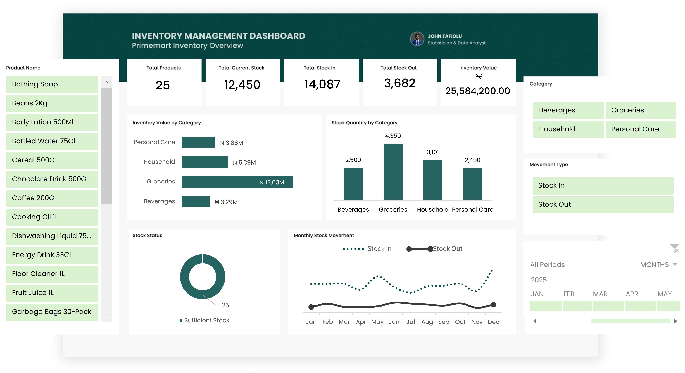

# PrimeMart Inventory Management & Stock Monitoring System

## Project Overview

The PrimeMart Inventory Management & Stock Monitoring System is an Excel-based inventory reporting solution designed to help a retail business monitor stock levels, track inventory movements, identify products requiring replenishment, and evaluate inventory value.

The project demonstrates how Microsoft Excel can be used to transform raw inventory records into a structured inventory management system with automated calculations, data validation, and interactive reporting.

## Business Problem

Retail businesses need accurate and up-to-date inventory information to avoid stock shortages, monitor incoming and outgoing goods, and make informed purchasing decisions.

Without a structured inventory management system, businesses may struggle to:
- Monitor available stock across products.
- Track stock received from suppliers.
- Monitor stock issued from inventory.
- Identify products approaching their reorder levels.
- Estimate the financial value of available inventory.
- Understand inventory movement over time.

This project addresses these challenges through an integrated Excel-based solution.

## Project Objectives

1. Monitor current inventory levels across products.
2. Track stock-in and stock-out transactions.
3. Identify products requiring replenishment.
4. Calculate reorder quantities.
5. Estimate inventory value.
6. Analyse inventory movement by month and category.
7. Develop an interactive dashboard for inventory reporting.

## Tools and Technologies

- Microsoft Excel
- Excel Tables
- Excel formulas and functions
- SUMIFS and IF functions
- PivotTables and PivotCharts
- Excel Data Model
- Data Model relationships
- Slicers and Timeline
- Conditional Formatting

## Dataset Description

The project uses two structured datasets:

### 1. Product Master Dataset
Contains 25 product records and includes:
- Product ID
- Product Name
- Category
- Unit
- Opening Stock
- Reorder Level
- Unit Cost
- Preferred Supplier

### 2. Stock Movements Dataset
Contains 600 inventory movement records and includes:
- Movement ID
- Date
- Product ID
- Movement Type
- Quantity
- Unit Cost
- Supplier or Reason
- Reference Number
- Recorded By

The datasets were organised into Excel Tables named `tblProductMaster` and `tblStockMovements`.

## Data Cleaning and Validation

Data preparation involved:

- Checking for duplicate Product IDs and Movement IDs.
- Identifying and resolving blank fields.
- Standardising text entries using TRIM and PROPER.
- Standardising Product IDs using UPPER and TRIM.
- Validating numeric fields and ensuring quantities were positive whole numbers.
- Checking date values for valid Excel date formats.
- Verifying that every Product ID in the Stock Movements table matched a record in the Product Master table.
- Confirming that the original record counts were preserved.

No records were deleted during cleaning.

## Inventory Calculations and Business Logic

The following calculated fields were added to the Product Master table.

### Total Stock In
Calculates the total quantity received for each product using SUMIFS.

### Total Stock Out
Calculates the total quantity issued for each product using SUMIFS.

### Current Stock
Calculated as:

`Current Stock = Opening Stock + Total Stock In - Total Stock Out`

### Stock Status
Products are classified using their current stock and reorder level:

- Reorder Required: Current Stock is less than or equal to Reorder Level.
- Sufficient Stock: Current Stock is greater than Reorder Level.

### Reorder Quantity
Calculates the additional quantity required to reach the reorder level, with a minimum value of zero.

### Inventory Value
Calculated as:

`Inventory Value = Current Stock × Unit Cost`

## Data Model and Relationships

Both Excel Tables were added to the workbook Data Model.

A relationship was established between:

- `tblStockMovements[Product_ID]`
- `tblProductMaster[Product_ID]`

The relationship enabled inventory analysis across both tables using PivotTables and PivotCharts.

## Interactive Dashboard

The dashboard provides a consolidated view of inventory performance through:

- Total Products KPI.
- Current Stock KPI.
- Total Stock In KPI.
- Total Stock Out KPI.
- Total Inventory Value KPI.
- Inventory Value by Category chart.
- Stock Quantity by Category chart.
- Stock Status chart.
- Monthly Stock Movement chart.

Interactive controls include:

- Category slicer.
- Product Name slicer.
- Movement Type slicer.
- Date Timeline.

The dashboard allows users to filter and explore inventory information dynamically.
## Dashboard Preview

## Key Findings

The analysis produced the following results:

| Metric | Result |
|---|---:|
| Total Products | 25 |
| Current Stock | 12,450 |
| Total Stock In | 14,087 |
| Total Stock Out | 3,682 |
| Total Inventory Value | ₦25,584,200.00 |

Additional observations:

- All 25 products were classified as having sufficient stock.
- No products required replenishment based on their current reorder levels.
- The calculated reorder quantity was zero across all products.

## Business Recommendations

1. Continue monitoring stock levels against established reorder thresholds.
2. Review reorder levels periodically to reflect changes in demand.
3. Maintain accurate stock-in and stock-out records.
4. Monitor inventory movement to identify changes in product activity.
5. Introduce regular inventory reconciliation to improve record accuracy.
6. Consider incorporating sales data to support demand forecasting and purchasing decisions.

## Limitations

- The inventory dataset represents a sample business scenario rather than verified operational records from a real company.
- Inventory value is estimated using the listed unit cost in the Product Master table.
- The model does not implement FIFO or weighted-average inventory costing.
- Stock-out transactions do not contain selling prices or cost-of-goods-sold information.
- The system does not currently include automated supplier purchase orders or external database integration.

## Project Outcome

The project demonstrates the application of Microsoft Excel to inventory management, data cleaning, data modelling, automated calculations, operational reporting, and interactive dashboard development.

It provides a structured approach to monitoring inventory performance and supporting routine stock management decisions.

## Author

**John Fafiolu**

Data Analyst | Statistics Graduate

- GitHub: https://github.com/JohnFafiolu
- LinkedIn: https://www.linkedin.com/in/john-fafiolu-5475b3274/
